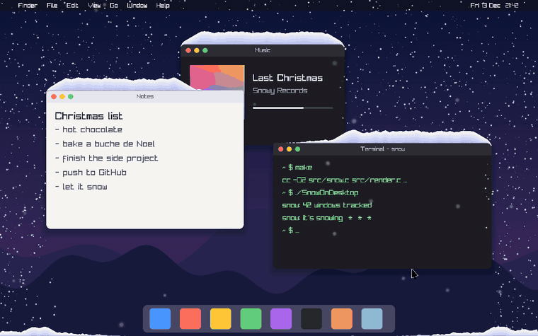

<div align="center">

# ❄️ Snow on Desktop

**It snows on your Mac, and the snow piles up on top of your windows.**

Drag a window and the snow slides off it. Shake it and the snow flies everywhere.
Close it and the snow falls onto whatever is underneath. Brush the snow away with your cursor.



*Written in C with [raylib](https://www.raylib.com). Tiny, native, no permissions needed.*

</div>

---

## ✨ Features

- **Real accumulation**: snow piles up on the top edge of every window, on the rounded corners, and drifts at the bottom of the screen
- **Physics**: move a window and its snow comes along; stop it suddenly or shake it and the snow keeps going (inertia)
- **Closing a window** drops its snow, which crumbles in the air and lands on the windows below
- **Cursor interaction**: sweep piles off with your mouse, and push falling flakes around
- **Depth**: tiny far-away flakes, regular flakes, and big blurry flakes close to the "camera"
- **Window stacking aware**: snow behind another window stays hidden, and comes back when you uncover it
- **Spaces aware**: switching desktops doesn't dump all your snow; it waits for you
- **Menu bar control** ❄︎: light snow, snow, blizzard, stop, melt everything, hide, launch at login (English / French)
- **Click-through**: it never gets in the way of your mouse or keyboard
- **No permissions**: it only reads window positions, never window contents or titles

## 📦 Install

1. Download `SnowOnDesktop-x.y.z-macOS.zip` from the [latest release](../../releases/latest)
2. Unzip and drag **Snow on Desktop.app** into `Applications`
3. The app isn't notarized by Apple (that costs $99/year), so the first time:
   **right-click the app → Open → Open**.
   If macOS still refuses, run:
   ```bash
   xattr -dr com.apple.quarantine "/Applications/Snow on Desktop.app"
   ```
4. A ❄︎ appears in your menu bar. Enjoy.

Works on macOS 11 Big Sur and later, Apple Silicon and Intel (universal binary).

## 🛠 Build from source

You only need the Xcode command line tools (`xcode-select --install`). raylib is downloaded and built automatically.

```bash
git clone https://github.com/Firmirsa/SnowingDesktop.git
cd SnowingDesktop
make run
```

Other targets:

| Command | What it does |
|---|---|
| `make` | builds `build/Snow on Desktop.app` |
| `make run` | builds and launches it |
| `make zip` | zipped app, ready for a GitHub release |
| `make demo` | scripted fake desktop (also works on Linux), used to record the GIF |
| `./build/snow-demo --record demo.mp4` | renders the demo video (needs `ffmpeg`) |

## 🧠 How it works

```
 CoreGraphics ──► window list (positions, z-order) ─┐
 CGEvent ───────► cursor position ──────────────────┤
                                                    ▼
                                         snow simulation (snow.c)
                                         • flakes: wind, sway, air pushed by the cursor
                                         • one height map per window top edge
                                         • piles settle to a natural slope, overflow the corners
                                         • window jerk → snow keeps its inertia and flies off
                                                    │
                                                    ▼
 transparent, click-through, always-on-top window (raylib + Cocoa) ◄── render.c
```

- `src/snow.c`: the simulation, pure C, no OS or graphics code
- `src/render.c`: draws piles and flakes (premultiplied alpha for the transparent overlay)
- `src/platform_mac.m`: the macOS layer: overlay window, window list, cursor, menu bar item
- `src/platform_demo.c`: a scripted fake desktop to develop and record on any OS

## 🗺 Roadmap

- [ ] Multiple monitors
- [ ] Snow on the menu bar and the Dock icons
- [ ] Snowman that builds up if you leave the snow long enough ☃️
- [ ] Settings: amount, flake size, wind
- [ ] Windows and Linux versions

## 📄 License

[MIT](LICENSE). Made with ❄️ by [@Firmirsa](https://github.com/Firmirsa).
